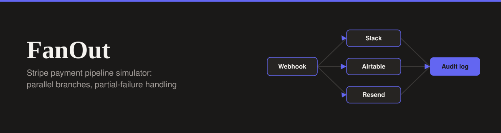

<div align="center">




</div>

# FanOut - Stripe Payment Pipeline Simulator

A premium B2B node-graph simulator that visualizes a parallel Stripe webhook fan-out pipeline. It acts as the UI layer for an n8n automation, showing how one payment event reaches several destinations at once and what happens when one of them fails.

**Live Demo:** [stripe-fanout.lovable.app](https://stripe-fanout.lovable.app)

## The Problem

Payment integrations cannot just run in series. If one destination, such as Slack, fails, it should not abort the others, such as Airtable or Resend. A serial pipeline turns one flaky integration into a lost receipt, a missing record, or a silent gap in the audit trail.

FanOut makes that behavior visible. Each branch runs independently, reports its own outcome, and the overall run status is derived from the combined result.

## n8n Workflow Reference

This UI visualizes a backend n8n workflow. You can view the actual workflow code and documentation in my platform integration portfolio:

- **Repository:** [platform-integration-portfolio](https://github.com/Xhenzouu/platform-integration-portfolio)
- **Workflow Documentation:** [Workflow 5: Stripe Payment Fan-Out](https://github.com/Xhenzouu/platform-integration-portfolio/blob/main/docs/workflows/05-stripe-payment-fanout.md)
- **Raw Workflow JSON:** [stripe-payment-fanout.json](https://github.com/Xhenzouu/platform-integration-portfolio/blob/main/workflows/stripe-payment-fanout.json)

The n8n workflow handles the following logic:

1. Receives a Stripe payment webhook and verifies its signature through a companion Node.js process.
2. Fans out to Slack, Airtable, and Resend in parallel.
3. Handles each branch's failure on its own, so one failing branch does not abort the others.
4. Records per-branch outcomes in a Supabase audit table.

This simulator mirrors that flow: the node graph shows the parallel branches, and the audit table and drawer show the per-branch outcomes.

## Features

- **Node Graph Visualization:** The pipeline is drawn as a node graph with Framer Motion pulse animations showing the event moving through each branch.
- **Interactive Failure Injection:** Toggle any branch to fail and watch the overall status flip to "partial" while the other branches continue to succeed.
- **Real-Time Audit Log:** A table that records each run and every branch outcome as it happens.
- **Error Detail Drawer:** A side drawer that shows the exact error payload for a failed branch.

## Engineering Notes

- **Parallel by design:** Branch outcomes are independent. A failure in one branch never blocks or cancels another.
- **Derived status:** The overall run status is computed from the branch results rather than stored separately, so the graph, the audit table, and the drawer always agree.

## Run Locally

1. Clone the repo:

   ```bash
   git clone https://github.com/Xhenzouu/stripe-fanout.git
   cd stripe-fanout
   ```

2. Install dependencies:

   ```bash
   npm install
   ```

3. Start the development server:

   ```bash
   npm run dev
   ```
